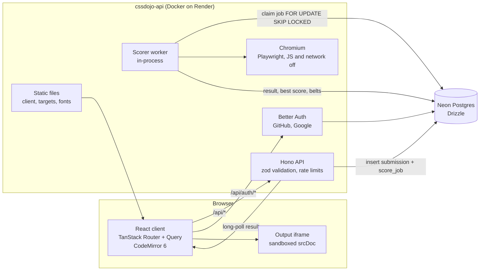
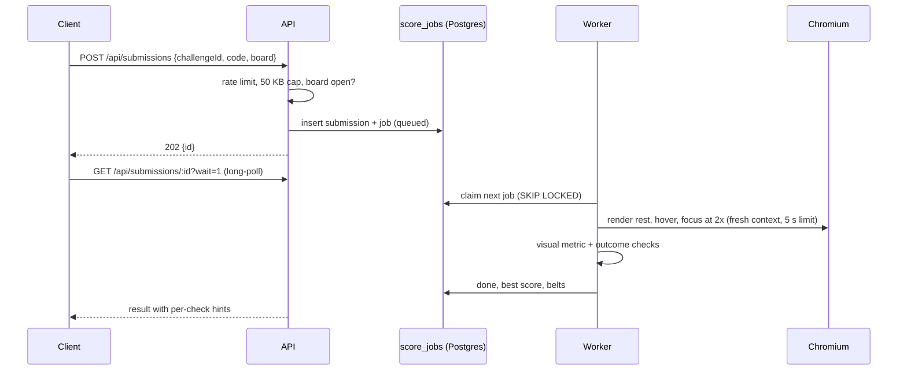
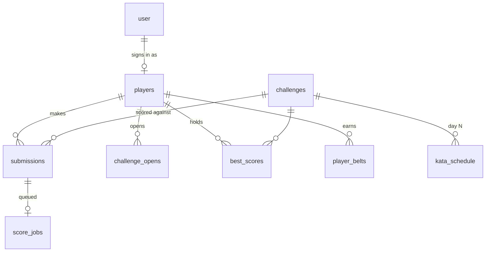

# Architecture

CSS Dojo is one Bun workspace with four packages and one deployable container.

## A Submit, step by step

## Packages

| Package | Role |
| --- | --- |
| `shared` | zod schemas and types for challenges, scores and the API; sanitizer; kata dates; fonts |
| `scorer` | renderer, visual metric, outcome checks, golden-set runner, target builder |
| `server` | Hono API, Drizzle schema and migrations, Better Auth, Postgres queue and worker |
| `client` | React app: play screen, kata, leaderboard, profile, gallery, asset sheet |

## Data model

A guest is a `players` row with no `user_id`. On first sign-in its rows move to the user's player (see ADR 0004).

Decisions are recorded in [../adr](../adr).
