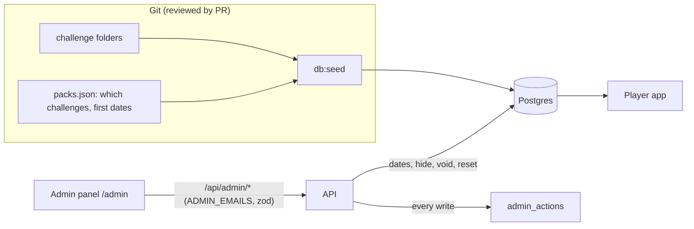

# Admin panel (v1)

Status: **approved by Abhi on 2026-10-28.** Decisions at the bottom.

## Why now

- The challenges in `challenges/` today are placeholders for testing. The team writes the final set before launch (target early January 2027).
- Once real players arrive, someone has to run the live app: move a pack date, hide a broken challenge, deal with a cheater, and see whether the scorer is keeping up. Today all of that needs a code change or raw SQL.

## How CSSBattle does it (what we copy)

- **The team makes every target.** No player-made or public authoring.
- **Content ships on a schedule.** Battles release one target a day for a set number of days, daily targets one per day.
- **Released targets stay fixed.** Scores stay comparable because the target never changes.

CSSBattle does not show its admin tools, so the panel below is our own design built around those three rules.

## Principles

1. **Challenges are written in git, not in the panel.** A challenge is a folder (`challenge.json`, starter, reference, note, golden set), reviewed by PR and guarded by the golden tests and the layout, value-scale and icon checks. The panel never edits challenge content.
2. **Released content is frozen.** Once anyone has scored on a challenge, its target, checks and starter never change. A fix ships as a new challenge, and the old one is hidden.
3. **The panel runs the live app:** schedule, visibility, moderation, health.
4. **Every admin action is logged** with who, what, when and why.
5. **Hide, never delete.** Hidden things keep their data, so a mistake is one click to undo.

## Who is an admin

- v1: an allowlist in the API env, `ADMIN_EMAILS` (comma-separated). One or two people do not need a roles table.
- The server checks it on every `/api/admin/*` request. The client hides the link too, but the server check is the real gate.
- Admin routes need a signed-in user (never a guest), and every request body is validated with zod.

## What v1 does

### 1. Schedule

- List every Battle Pack with its state (upcoming, live, finished), open and end dates, and player count.
- **Upcoming pack:** change the open and end dates.
- **Live pack:** extend the end date only. Never move the open date back or end it early.
- **Finished pack:** read only. Its final standings are frozen.
- Kata order is not changed here. `db:seed` rebuilds the kata cycle from each kata's `kataDay` on every deploy, so a swap made in the panel would be undone. Kata order is content and changes by PR.

### 2. Challenges

- List every challenge: number, belt, pack, state (visible or hidden), golden score range, players, pass rate (90+), average best score.
- Preview the target frames (rest, hover, focus) and the reference next to each other.
- **Hide** a challenge: it leaves lists, packs and the kata cycle, but scores, points and badges already earned stay. **Unhide** puts it back.

### 3. Players

- Search by handle or email.
- Player page: belt, points, Wall rank, recent submissions with scores and code.
- **Hide from boards** (for cheating or abuse): the player can still play, but no board or LIVE line shows them. Undo is one click.
- **Reset handle**: clears an offensive handle and makes the player pick a new one.
- **Void a submission**: it stops counting. The player's best score and points are rebuilt from the remaining submissions (only ones from before a solutions lock), and belts they no longer qualify for are taken back. Badges already earned stay: they are only ever added.

### 4. Health and stats

- Today and the last 30 days: sign-ups, active players, Submits, solves.
- Scorer: queue depth, oldest waiting job, failed jobs in the last 24 hours, average time to score.

### 5. Audit log

- Every write above adds a row: admin, action, target, before and after values, a required short reason, and the time.
- The panel lists it newest first.

## Not in v1

- Writing or editing challenges in the browser (principle 1).
- Editing a released challenge (principle 2).
- Emails, announcements or a message to all players.
- Several admin roles or permissions.
- Deleting anything.

## Data changes (one migration)

- `challenges.hidden_at` and `players.hidden_at` (nullable timestamps).
- `submissions.voided_at` plus `voided_by`.
- `admin_actions` table for the audit log.
- **Pack dates move to the database.** Today `bun run db:seed` copies dates from `challenges/packs.json` every time, so it would undo a date set in the panel. After this change, `packs.json` sets which challenges are in a pack and the starting dates for a new pack, and the seed only writes dates when it first inserts a pack.

## How it is built

- Routes live in `server/src/routes/admin.ts`, mounted at `/api/admin` behind `requireAdmin` (`server/src/admin/guard.ts`). Non-admins get a 404, so the routes do not show they exist.
- Pack dates and hidden challenges are read on almost every request, so they stay in memory (`server/src/packs.ts`). `server/src/admin/overrides.ts` loads them from Postgres at start, right after each admin change, and every minute (for a separate worker process). See ADR 0008.
- A hidden player is left out of every board, the LIVE line and pack finals, except on their own views, so they are not told.
- A hidden kata means no kata that day. The cycle does not shift.
- The client page is `client/src/pages/Admin.tsx` at `/admin?tab=...`. The sidebar shows the Admin link only to admins.

## Rough size

About a week of work: the migration and seed change, admin middleware and routes with tests, and four screens in the existing dojo shell style. Recalculating a player after a voided submission is the trickiest part and needs a Postgres test.

## Decisions (2026-10-28)

1. **Admins:** the `ADMIN_EMAILS` allowlist. No role column in v1.
2. **Hiding a challenge** is an emergency switch (unsolvable after a scorer bug, a 100 without really building it, content we should not use). It keeps the points players already earned there.
3. **Hiding a player** is for board abuse (copied solutions on fresh accounts, scripted Submits, offensive handles). The player is not told; they still see themselves on their own profile. Undo is one click.
4. **Content:** Abhi writes the final challenges. Launch set: at least 1 Battle Pack (6 challenges) and a kata for every day of January 2027 (31). Plan a second pack for mid-January, because one pack only lets players earn one belt. The placeholder challenges are removed before real players arrive.
